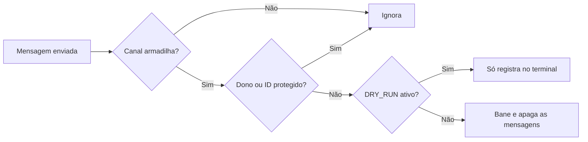

<div align="center">


<br>


**Um canal armadilha, zero spam.**
Se alguém escrever nele, o bot bane na hora e limpa a bagunça.

[Sobre](#-sobre) •
[Instalação](#-instalação) •
[Configuração](#-configuração) •
[Uso](#️-uso) •
[Segurança](#-segurança) •
[Roadmap](#-roadmap)

</div>

---

## 🍯 Sobre

Contas hackeadas costumam mandar a mesma mensagem de spam em **todos os canais** que conseguem ver,
muitas vezes com links de golpe. Moderar isso manualmente é cansativo, e quando você percebe o estrago já foi feito.

O **Honeypot Bot** resolve com uma ideia simples: um canal "pote de mel" que nenhum membro de verdade
precisa usar. Spammers escrevem em tudo o que enxergam, então caem nele. O bot detecta a mensagem,
**bane o autor** e **apaga as mensagens da última hora**, antes que o spam se espalhe.

> Projeto feito em Python como estudo de bots, eventos assíncronos e da API do Discord.

## ✨ Funcionalidades

| | Recurso | Descrição |
|---|---|---|
| 🚫 | **Banimento instantâneo** | Quem escrever no canal armadilha é banido na hora |
| 🧹 | **Limpeza automática** | Apaga as mensagens enviadas pelo autor na última hora |
| 📌 | **Vários canais** | Aceita mais de um canal armadilha ao mesmo tempo |
| 🛡️ | **IDs protegidos** | Lista de pessoas que nunca são banidas (o dono do servidor é sempre protegido) |
| 🧪 | **Modo simulação** | `DRY_RUN` mostra quem seria banido, sem banir ninguém |
| 🔒 | **Token fora do código** | Lido de um `bot.env` que o Git ignora |

> **Atenção:** admins e moderadores **também são banidos** se escreverem no canal, a menos que estejam
> em `PROTECTED_USER_IDS`. Isso é de propósito: contas de admin hackeadas são as mais perigosas.

## ⚙️ Como funciona



Exemplo do que aparece no terminal:

```text
Online como Honeypot#1234 | Modo: ATIVO (bane de verdade)
Canais armadilha: {1234567890123456789}
Banido: spammer#0000 (987654321098765432) em Meu Servidor
```

## 📋 Pré-requisitos

- [Python 3.8+](https://www.python.org/downloads/) (no Windows, marque **Add Python to PATH** na instalação)
- Permissão de **Gerenciar Servidor** no servidor onde o bot vai atuar
- Um bot criado no [Discord Developer Portal](https://discord.com/developers/applications)

## 🚀 Instalação

```bash
# 1. Clone o repositório
git clone https://github.com/SEU_USUARIO/honeypot-bot.git
cd honeypot-bot

# 2. Crie e ative o ambiente virtual
python -m venv venv
venv\Scripts\activate          # Windows (PowerShell)
# source venv/bin/activate     # Linux / macOS

# 3. Instale as dependências
pip install -r requirements.txt
```

## 🔧 Configuração

### 1. Criar o bot no Discord

1. No Developer Portal, clique em **New Application** e abra a aba **Bot**.
2. Clique em **Reset Token** e copie o token. Ele é a senha do bot.
3. Em **OAuth2 → URL Generator**, marque o escopo `bot` e as permissões **View Channels** e **Ban Members**.
4. Abra a URL gerada e adicione o bot ao servidor.

> Nenhuma *Privileged Gateway Intent* é necessária.

### 2. Preparar o servidor

1. Em **Configurações do Servidor → Cargos**, arraste o cargo do bot para **acima** de todos os cargos que ele deve poder banir.
2. Crie um canal de texto, como `⛔-nao-escreva-aqui`, com um aviso na descrição e uma mensagem fixada.
3. Deixe o `@everyone` com **Ver canal** e **Enviar mensagens** ativados nele.
4. Ative o **Modo Desenvolvedor** (Configurações do Usuário → Avançado) e copie o ID do canal e o seu ID de usuário.

### 3. Criar o `bot.env`

```bash
copy bot.env.example bot.env      # Windows
# cp bot.env.example bot.env      # Linux / macOS
```

| Variável | Descrição |
|---|---|
| `DISCORD_TOKEN` | Token do bot (Developer Portal → Bot) |
| `HONEYPOT_CHANNEL_IDS` | ID(s) do(s) canal(is) armadilha, separados por vírgula |
| `PROTECTED_USER_IDS` | ID(s) de quem nunca deve ser banido |
| `DRY_RUN` | `true` só simula, `false` bane de verdade |

## ▶️ Uso

```bash
python bot.py
```

Para parar, use `Ctrl + C`.

### 🧪 Testando com segurança

1. Use um **servidor de teste** só seu e uma **conta secundária**. O dono e os IDs protegidos nunca são banidos.
2. Comece com `DRY_RUN=true` e confirme que aparece `[SIMULAÇÃO] Baniria ...` no terminal.
3. Mude para `DRY_RUN=false` e repita: a conta de teste deve ser banida e a mensagem apagada.
4. Remova o banimento em **Configurações do Servidor → Banimentos**.
5. Só então adicione o canal do servidor oficial em `HONEYPOT_CHANNEL_IDS`.

### 🖥️ Iniciar junto com o Windows

1. Aperte `Win + R`, digite `shell:startup` e dê Enter.
2. Coloque ali um atalho para o `iniciar_bot.bat`.

O bot abre sozinho quando você entrar no Windows. Ele só funciona enquanto o PC estiver ligado.

## 🔐 Segurança

- **Nunca** publique o `bot.env` nem o token. O `.gitignore` já bloqueia esse arquivo.
- Se o token vazar, gere outro em **Developer Portal → Bot → Reset Token**.
- Dê ao cargo do bot **apenas** `Banir Membros` e `Ver Canais`. Nunca `Administrador`.
- Como o cargo precisa ficar acima de quem será banido, trate o token como a chave do servidor.
- Avise a comunidade sobre o canal, para ninguém ser banido por curiosidade.
- Incentive os admins a ativarem a autenticação em dois fatores (2FA).

## 🩺 Solução de problemas

<details>
<summary>Clique para ver os erros mais comuns</summary>

<br>

| Sintoma | Causa provável |
|---|---|
| `Defina DISCORD_TOKEN e HONEYPOT_CHANNEL_IDS` | `bot.env` ausente, com nome errado (`bot.env.txt`) ou sem os valores |
| `LoginFailure: Improper token` | Token errado ou resetado; gere outro |
| `Sem permissão...` | Cargo do bot abaixo do cargo da pessoa, ou falta `Ban Members` |
| Bot online, mas nada acontece | ID do canal errado, ou o bot não enxerga o canal |
| Só aparece `[SIMULAÇÃO]` | `DRY_RUN` ainda está `true` |
| `TypeError` em `delete_message_seconds` | `discord.py` antigo; rode `pip install -U discord.py` |

</details>

## 🗺️ Roadmap

- [x] Vários canais armadilha
- [x] Modo simulação (`DRY_RUN`)
- [x] Lista de IDs protegidos
- [x] Início automático no Windows
- [ ] Log de banimentos em um canal de moderação
- [ ] Hospedagem 24h (VPS)
- [ ] Comandos para gerenciar a lista de protegidos pelo próprio Discord

## 📁 Estrutura do projeto

```text
honeypot-bot/
├── assets/
│   └── banner.svg      # banner do README
├── bot.py              # código do bot
├── bot.env.example     # modelo de configuração
├── requirements.txt    # dependências
├── iniciar_bot.bat     # atalho para iniciar no Windows
├── LICENSE
├── .gitignore
└── README.md
```

## 🤝 Contribuindo

Sugestões e *pull requests* são bem-vindos. Abra uma *issue* para conversar sobre mudanças maiores.

## 📄 Licença

Distribuído sob a licença MIT. Veja o arquivo [LICENSE](LICENSE) para mais detalhes.

---

<div align="center">

Feito com 💜 por [SEU_NOME](https://github.com/SEU_USUARIO)

⭐ Se o projeto te ajudou, deixe uma estrela no repositório.

</div>
